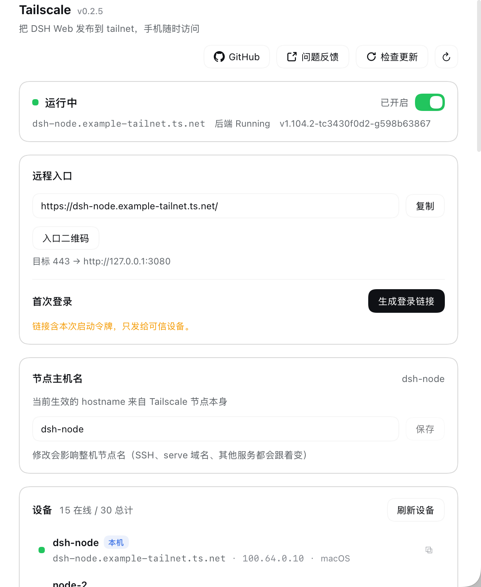
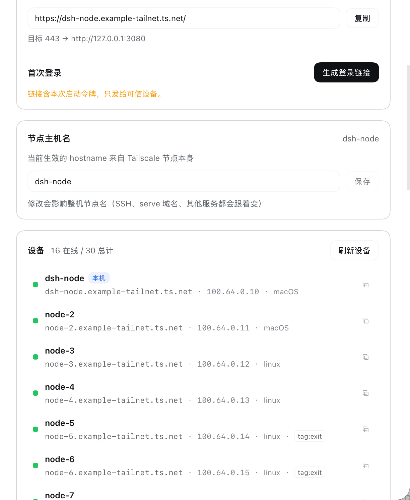
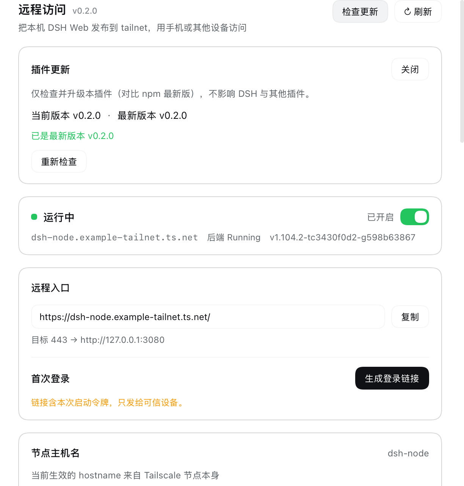

# dsh-tailscale

[](https://www.npmjs.com/package/@ponydev/dsh-tailscale)
[](LICENSE)

**DeepSeek Harness（DSH）Web 插件：把 DSH Web GUI 发布到你的 tailnet，并把 tailnet 设备与可达性作为 `ctx.tailscale` 服务提供给其他插件。**

- **远程入口**：随 DSH 启动自动把 Web 发布到 `https://<节点>.<tailnet>.ts.net/`，手机/平板在任何网络下打开一个网址就能用
- **统一 Tailscale 向导**：检测 → 安装 → 启动 → 登录（本地二维码 / auth key）→ 配置 hostname，全在「设置 → Tailscale」里完成
- **设备感知**：`ctx.tailscale.devices()` / `probe()` 把 tailnet 节点和 TCP 可达性交给其他插件（dsh-phone 等），插件本身不认 adb/hdc/ssh
- **会话头部图标**：绿/红/灰状态点，点击直达设置；30 秒轮询，页面隐藏时暂停
- **二维码**：远程入口和登录链接都能在浏览器本地生成二维码（手机扫一下即可；二维码不经第三方，token 不出本机）
- **设置页头部**：显示当前版本 + **GitHub** / **问题反馈** / **检查更新** / 刷新 按钮组；检查更新会对比 npm 最新版并给出升级命令
- **私网使用**：只用 `tailscale serve`（tailnet 内），**永不启用 Funnel**






## 安装

要求 DSH `>= 0.2.0-rc.2 < 0.3.0`、Node.js `>= 22.5`；本机已安装 Tailscale（没有的话插件可以引导安装）。

```bash
# CLI
dsh plugin --profile web add @ponydev/dsh-tailscale

# 或在 Web「插件」页搜索安装
```

装完重启宿主（`launchctl kickstart -k gui/$(id -u)/local.deepseek-harness.web`）并刷新页面，然后打开 **设置 → Tailscale**。

### 本地开发

```bash
dsh plugin --profile web add link:/path/to/dsh-tailscale
```

Host 侧改完重启 `dsh web`（或 touch profile 的 `cordis.patch.yml` 触发重组合）；`lib/client.js` 改完保存后浏览器通常免刷新（`dsh-client-hmr`）。

## 功能特性

### 远程入口（入站）

启动时（`autoPublish: true`）：

1. 读取 `tailscale status --json`，确认 `BackendState === "Running"`，拿到 `Self.DNSName`
2. 读取 `tailscale serve status --json`，按四态处理目标路由：
   - `absent` → 创建 `tailscale serve --bg --https=<httpsPort> [--set-path=<path>] http://127.0.0.1:<webPort>`
   - `exact` → 认领（上次崩溃/重启留下的路由），不重建
   - `stale` → 重建；`conflict` → **只报错，不覆盖**别人的路由
3. 把 `<dnsName>` 推进 `connection.trustedHosts`（`serve` 保留 Host 头，不推进会导致远程 `/api` 403）
4. 写 `$DSH_HOME/tailscale.json`（`0600`，只含 URL/端口/归属，**不存 token**）

运行期每 60 秒做一次轻量自愈：入口路由丢了（HMR 重载竞态、外部 `serve reset`、Tailscale 重启）就自动重建。正常退出时只撤自己那条 `serve` 路由（末位 `off`），**绝不** `serve reset`、**绝不** `tailscale down`。

### 统一 Tailscale 安装向导

插件统一管理**本机这一套** Tailscale，不创建独立节点、不产生第二套 state/登录/hostname：

| 状态 | 设置页行为 |
|---|---|
| 未安装 | 「安装 Tailscale」：macOS 优先 `brew install --cask tailscale-app`，没有 brew 则下载官方 pkg 并通过**系统授权弹窗**安装（插件不接触密码）；安装中显示日志，2 秒轮询状态 |
| 已安装未运行 | 「启动 Tailscale」 |
| 未登录 | **本地二维码**（AuthURL，60 秒后自动隐藏，不上传）或 **auth key**（环境变量 `TAILSCALE_AUTH_KEY` 或临时粘贴；只在 Host 内存/`0600` 临时文件中，不落盘不进日志） |
| 运行中 | 「开启入口」、复制手机登录链接 |
| 已发布 | 手机入口、关闭入口 |

节点 hostname 可在设置页修改（默认不动）；修改会二次确认并提示影响整机（SSH、serve 域名、其他服务）。

### 手机登录（一次，跨重启可用）

设置页「远程访问」→「生成登录链接」会调用 DSH 的 `connection.authenticatedUrl()`，得到带本次进程 launch token 的链接。手机打开一次 → DSH 换成持久 cookie（签名密钥存在 credentials，默认 30 天）→ 之后直接打开 `https://<节点>.<tailnet>.ts.net/` 即可，**跨 DSH 重启不用重新登录**。

链接含令牌，属敏感信息：UI 展示 60 秒后自动隐藏，插件不落盘、不打日志。

### 会话头部图标

会话右上角工具区有一个 Tailscale 图标（和手机图标同排）：

- 右下角状态点：**绿** = 在线（Running），**红** = 未运行/未登录，**灰** = 状态未知（Host 接口不可用）
- 悬停显示 `Tailscale · 在线 · <节点域名> · 入口已开启 · 17/30 设备在线`
- 点击直接打开 **设置 → Tailscale**
- 状态每 30 秒刷新一次，页面隐藏时暂停；不存任何 token

### 设备感知（出站，给其他插件用）

`ctx.tailscale` 把 tailnet 事实暴露给 DSH 内部：设备清单（在线/离线、OS、IP、tags、直连/DERP）、`probe(host, port)` 单次 TCP 可达性、发布状态与订阅。**只提供网络事实，不实现任何设备协议**。

## 配置（`cordis.patch.yml`）

```yaml
- insert:
    - id: tailscale
      name: "@ponydev/dsh-tailscale"
      config:
        autoPublish: true       # 启动自动发布入口
        httpsPort: 443          # serve 的 HTTPS 端口
        publishPath: /          # 单实例用 /；多实例可用 /dsh2
        unpublishOnExit: true   # 退出撤回自己建的路由
        adoptExisting: true     # 认领上次崩溃残留（target 精确匹配才认）
        trustHost: true         # 自动维护 connection.trustedHosts
        cliPath: auto           # auto | 显式 CLI 路径
        deviceTtlMs: 10000      # status --json 缓存
        probeTimeoutMs: 800     # probe() 默认超时
        allow: []               # 设备过滤正则（按 hostName/dnsName/tags）
        allowAutoInstall: true  # 允许插件代跑安装命令（仍有系统授权/二次确认）
        installMethod: auto     # auto | brew | pkg | manual
        authKeyEnv: TAILSCALE_AUTH_KEY
```

## 给其他插件用：`ctx.tailscale`

**可选依赖**：不要写进 `inject`（服务不存在时插件会整个不启动），在请求处理时用 `ctx.get('tailscale')` 惰性取：

```js
const tailscale = ctx.get('tailscale')
if (tailscale) {
  const peers = await tailscale.devices({ online: true })
  const hit = await tailscale.probe(peers[0].dnsName, 5555) // 单次 TCP connect
  const info = await tailscale.publication()
  const off = tailscale.subscribe(() => { /* 入口/设备变化 */ })
}
```

常用方法：

| 方法 | 说明 |
|---|---|
| `status({ fresh })` | Tailscale 后端状态 + 本机节点 |
| `devices({ fresh, online, allow })` | tailnet 设备列表（`TailnetDevice[]`） |
| `device(ref)` | 按 hostName / dnsName / IP 前缀查单个设备 |
| `publication({ fresh })` | 远程入口状态（`enabled` / `url` / `owned` / `adopted` / `routeState`） |
| `health({ deep })` | 诊断报告（`checks[]` 带 `level` / `hint` / `command`） |
| `probe(host, port, { timeoutMs })` | tailnet 内单次 TCP 可达性（不握手、不发协议数据） |
| `subscribe(fn)` | 入口变化订阅（`publish` / `unpublish` / `change`） |
| `config` | 只读配置快照 |

`devices()` 数据结构（节选）：`{ id, hostName, dnsName, ips, os, online, tags, lastSeen, direct, relay, isSelf }`。

约定：`devices()` 只给 tailnet 事实，不认协议；`probe()` 只接受 tailnet 网段地址或当前设备清单里的主机（避免变成任意端口扫描器）。安装/登录/hostname 等管理方法也挂在服务上，但消费方通常不需要。

Host 侧 RPC（给浏览器，全部 `POST /tailscale/<endpoint>` 且先过 `connection.admit()`）：`snapshot`、`status`、`health`、`login-url`、`publish`、`unpublish`、`devices`、`setup`、`install`、`start`、`auth-url`、`login`、`hostname`、`update-check`。客户端必须用**相对路径**调用，以兼容 `/dsh2/` 之类挂载前缀。

## 检查更新

设置页「远程访问」标题右侧显示当前版本（`vX.Y.Z`），旁边「检查更新」按钮会：

1. 让 Host 侧 `POST /tailscale/update-check` 读取 npm registry 的 `@ponydev/dsh-tailscale/latest`
2. 对比 `package.json` 版本，显示「当前 / 最新」与升级命令
3. 有新版本时给出一条可复制的命令：`dsh plugin --profile web add @ponydev/dsh-tailscale@<最新版>`

检查是**只读**的：不登录、不上报标识、不自动升级、不改 profile；结果缓存 10 分钟，可手动重试。



## 安全边界

- `/tailscale/*` 全部经 `connection.admit()`：未认证 401，跨站 Origin 403；`login-url` 只对已认证请求现取现给
- **不自动执行 `tailscale up` / `down` / `login` / `logout`**：扫码/AuthURL 与 auth key 登录只在用户显式点击后由用户发起；插件永不 `down`、永不 `logout`
- **永不启用 Funnel**；只用 `serve`（tailnet 内），健康检查会检测 `AllowFunnel` 并告警
- auth key 不落盘、不进日志、不回显；二维码（AuthURL）由本机前端生成，内容不上传
- 命令一律 `execFile` + 参数数组 + 超时，不经过 shell；`conflict` 路由只报错不覆盖
- 不存 token/cookie；状态文件 `0600`；`probe()` 只探 tailnet 地址
- 默认不修改系统 Tailscale 节点身份（hostname），修改需用户显式输入并二次确认

## 排障

看 **设置 → Tailscale → 诊断**（每项带下一步提示和可复制命令）。常见状态：

| 状态 | 含义 | 处理 |
|---|---|---|
| 未安装 | 找不到 tailscale CLI | macOS 装 standalone 版；或配置 `cliPath` |
| 未运行 / 未登录 | `BackendState` 不是 Running | 用设置页「启动 Tailscale」或扫码/auth key 登录 |
| HTTPS 未启用 | tailnet 没开 HTTPS/MagicDNS | 在 Tailscale 管理台开启 |
| 路由冲突 | 该域名/path 已指向别的服务 | 设置页显示现有路由，先手动处理（插件不覆盖） |
| 信任未生效 | 远程页面能开、发消息 403 | 重新开启入口；或在 profile patch 里加 `trustedHosts` |
| 入口偶发丢失 | HMR / 外部 `serve reset` / Tailscale 重启 | 60 秒内自愈重建；也可在设置页关闭再开启 |

命令行自查（不打印 token）：

```sh
/Applications/Tailscale.app/Contents/MacOS/Tailscale status --json | head -5
/Applications/Tailscale.app/Contents/MacOS/Tailscale serve status
curl -sI https://<节点>.<tailnet>.ts.net/   # 401 = 入口可达（正常）
```

## 开发

```sh
npm run check         # 语法检查（node --check）
npm run smoke         # 冒烟：假 CLI + 单元/服务层/RPC 测试，全部离线
npm run check-i18n    # zh/en 字典键一致 + 代码用键存在
npm run release-notes # 从 CHANGELOG 抽取当前版本发布说明
npm pack --dry-run    # 发布内容检查
```

- 开发环境、联调方式、提交前检查：[CONTRIBUTING.md](CONTRIBUTING.md)
- 项目级规范（AI/自动化代理必读）：[AGENTS.md](AGENTS.md)
- **发布流程（tag 触发自动发布，OIDC 无 token）**：[RELEASE.md](RELEASE.md)
- 架构与阶段计划：[docs/DESIGN.md](docs/DESIGN.md)

## License

[MIT](LICENSE)
